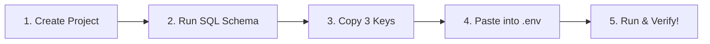

# 🚀 Connecting MedLabel AI to Live Supabase: Step-by-Step Guide
*(Written for beginners — simple, complete, and with zero steps skipped!)*

---

## 💡 What is Supabase & Why Do We Need It?
Think of Supabase as two things working together for MedLabel AI:
1. **A Cloud Filing Cabinet (Database)**: It saves your medical devices, AI labels, audit history, and compliance checks so they don't disappear when you close your computer.
2. **A Security Guard (Authentication & RLS)**: It ensures that User A cannot see or edit User B's confidential medical labels.

---

## 📋 The 5 Easy Steps to Connect



---

## 🟢 Step 1: Create Your Free Supabase Project
*(Skip this step if you already created your project)*

1. Open your browser and go to: **[https://supabase.com](https://supabase.com)**
2. Click the green **"Start your project"** or **"Sign in"** button (you can sign in with your GitHub account or email).
3. You will land on your Supabase Dashboard. Click the green button that says **"+ New project"**.
4. Choose an organization (usually your name).
5. Fill in the project details:
   - **Name**: Type `medlabel-ai`
   - **Database Password**: Pick a password or click "Generate a password". *(Copy this somewhere safe, you might need it later!)*
   - **Region**: Pick the region closest to you (e.g. `Central India (Mumbai)`, `East US`, or `West Europe`).
   - **Pricing Plan**: Choose **Free tier**.
6. Click **"Create new project"**.
7. Wait about 1 to 2 minutes while Supabase sets up your database. When it finishes, your project dashboard will open.

---

## 🟢 Step 2: Create the Database Tables & Security Rules (SQL Editor)

Your project needs special tables (like `devices`, `label_projects`, `reviews`, `audit_logs`). We already wrote all the code for this in a file called `supabase/schema.sql`. You just have to run it once:

1. In your Supabase Dashboard, look at the **left sidebar** (the column of icons on the left edge of your screen).
2. Click on the icon that looks like **SQL** or a terminal: **"SQL Editor"** (it is usually the 4th icon down).
3. Click the button near the top left that says **"+ New query"** (or click "Create a new snippet").
4. A blank coding area will open in the middle of your screen.
5. In your code editor (VS Code / Antigravity), open the file:
   - **File location**: `medilabel/supabase/schema.sql`
   - Press **Ctrl + A** to select all text.
   - Press **Ctrl + C** to copy it.
6. Go back to your browser window where the Supabase SQL Editor is open.
7. Click inside the blank box and press **Ctrl + V** to paste the entire code.
8. Look at the bottom-right of the query box: click the green button that says **"Run"** (or press **Ctrl + Enter** on your keyboard).
9. At the bottom, you should see:
   > `Success. No rows returned`
10. **Done!** All your database tables, foreign keys, and security rules are now live.

---

## 🟢 Step 3: Find Your 3 Magic API Keys

To let MedLabel AI communicate with your cloud Supabase, you need 3 pieces of information:

1. In the Supabase left sidebar, look all the way at the bottom and click the **gear icon ⚙️ ("Project Settings")**.
2. A settings menu will slide out. Click on **"API"** (under Configuration).
3. You will now see a page with your keys:

| What to look for on screen | Description | What it looks like |
|---|---|---|
| **Project URL** | Your database's web address | `https://abcdefghijklm.supabase.co` |
| **Project API Keys** → `anon` `public` | Public access key | Starts with `eyJhbGci...` |
| **Project API Keys** → `service_role` `secret` | Backend master key (Click **"Reveal"** to see it) | Starts with `eyJhbGci...` |

*(Leave this browser tab open so you can copy and paste them!)*

---

## 🟢 Step 4: Put the Keys into MedLabel AI (.env files)

A `.env` file is a special secret file where applications store sensitive passwords and URLs so they don't get shared publicly.

In Windows, `.env` files can sometimes be hidden. Here is how to find or edit them:

### Method A: Open Directly in your Editor
1. In your editor, look at the project folder on the left:
   - `medilabel/.env` (Root folder)
   - `medilabel/backend/.env` (Inside the `backend` folder)
2. Open both files.
3. Make sure they contain these lines (replace the placeholder text with your real values from Step 3):

```env
# 1. Your Project URL from Step 3
SUPABASE_URL=https://your-project-id.supabase.co

# 2. Your anon public key from Step 3
SUPABASE_ANON_KEY=eyJhbGciOi...

# 3. Your service_role secret key from Step 3
SUPABASE_SERVICE_ROLE_KEY=eyJhbGciOi...

# 4. Frontend copies (used by Vite)
VITE_SUPABASE_URL=https://your-project-id.supabase.co
VITE_SUPABASE_ANON_KEY=eyJhbGciOi...

# 5. Disable demo fallback so it talks to live Supabase
USE_DEMO_STORE=false
```

4. Save both files (**Ctrl + S**).

*(Or simply paste the 3 keys in our chat and Antigravity will write them to both files automatically for you!)*

---

## 🟢 Step 5: Test and Verify the Connection!

We built an automated test script that tests everything in 5 seconds without you having to do anything manually.

### 1. Run the Security & RLS Test Script
Open PowerShell in your project and run:
```powershell
& "C:\Users\asus\AppData\Local\Programs\Python\Python313\python.exe" backend/test_supabase_live.py
```

### What You Will See When Successful:
- `✓ Step 1: Connecting to live Supabase project... (HTTP 200)`
- `✓ Step 2: Testing real Supabase Auth (Creating 2 distinct users)...`
- `✓ Step 3: Verifying Row Level Security (Multi-Tenant Isolation)...`
- `✓ Step 4: Verifying Full Entity Persistence (Devices, Versions, Reports, Reviews, Audit)...`
- `✓ Step 5: Testing No-Silent-Fallback enforcement...`
- `ALL LIVE SUPABASE & RLS SECURITY CHECKS PASSED!`

---

## 🟢 Step 6: Start Your Live App!

Now restart your servers:
1. **Backend**:
   ```powershell
   cd backend
   & "C:\Users\asus\AppData\Local\Programs\Python\Python313\python.exe" -m uvicorn main:app --reload --port 8000
   ```
   *You will see:* `[Database] Connected to live Supabase database.`

2. **Frontend**:
   ```powershell
   cd frontend
   npm.cmd run dev
   ```
   *Open:* `http://localhost:5173`

---

## ❓ Common Questions & Troubleshooting

- **Q: How do I know if I am using live Supabase or demo mode?**
  - In `backend/database.py`, if `SUPABASE_URL` is configured and valid, the console will print:
    `[Database] Connected to live Supabase database.`
  - If keys are missing, it will clearly say:
    `[Database] No Supabase credentials configured. Running in demo mode with in-memory store.`

- **Q: What if I get an RLS permission denied error?**
  - This means Row Level Security is doing its job! A user must be logged in to create or view their own devices.

- **Q: Are my secrets safe?**
  - Yes! `.env` and `backend/.env` are in `.gitignore`. They will **never** be pushed to GitHub.
